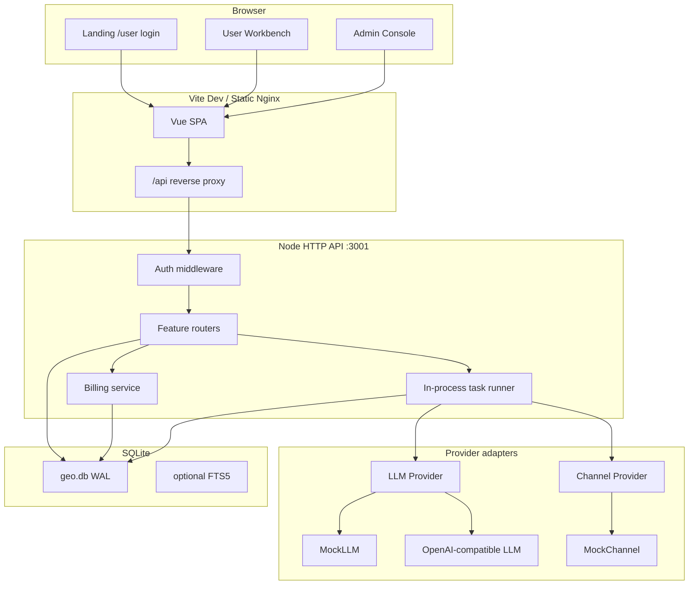
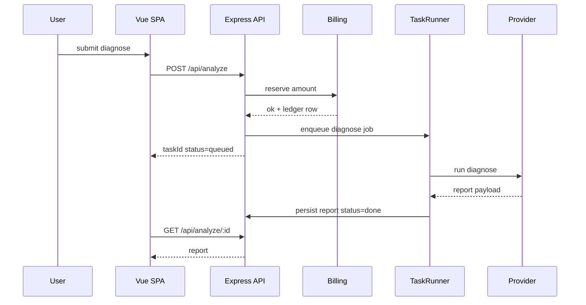

# GEO 生成式引擎优化系统技术设计

Feature Name: geo-system
Updated: 2026-10-11

## Description

GEO System 是一套独立部署的 Web SaaS，对齐站长之家 GEO 用户后台的信息架构与操作闭环：

诊断可见度 → 蒸馏关键词/意图问题 → 沉淀企业素材 → AI 写作/视频 → 多渠道发布 → 收录监测 → 点数/余额结算。

本期范围（已确认两轮 1A / 2A / 3A）：

- 功能：完整对齐参考站全部用户菜单。
- 形态：官网落地页 + 用户工作台 + 精简管理端，三者同一前端应用、按路由与角色切换。
- 外部依赖：任务、扣费、报告结构为真实实现；大模型与外发渠道通过 **Provider 适配器** 接入，默认走内置模拟器，配置 Key 后可切换真实 LLM。无 Key 时全流程可演示。
- UI：信息架构、字段、流程对齐参考站；视觉用简洁蓝紫工作台，不做像素级仿站。
- 管理端：独立 `/admin`，含实名审核、调账、任务监控、标价四页。
- 种子数据：12+ B2B/媒体站点、6 个 AI 平台、示例关键词/文章/报告，打开即有数。

运行环境约束：无 Docker、无常驻 MySQL/ES，检索与持久化使用 SQLite；前端开发服务器需配置 `allowedHosts: ['.monkeycode-ai.online']`，并以 `/api` 反代后端。

## Architecture



### 请求与任务流



### 部署拓扑（本环境）

| 进程 | 端口 | 职责 |
|------|------|------|
| `server` Node | 3001 | REST API、任务 runner、SQLite |
| `web` Vite | 5173 | SPA + `/api` 反代到 3001，对外预览入口 |
| `start.sh` | - | 同时拉起两端 |

生产同构：静态 `web/dist` + Node API，由反向代理把 `/api` 指到 API。

### 目录结构

```
/workspace/geo-system/
  start.sh
  README.md
  server/
    package.json
    src/index.js
    src/db.js
    src/auth.js
    src/billing.js
    src/tasks.js
    src/providers/llm.js
    src/providers/channel.js
    src/routes/*.js
    data/geo.db
  web/
    package.json
    vite.config.ts
    index.html
    src/main.ts
    src/router.ts
    src/api.ts
    src/layouts/WorkbenchLayout.vue
    src/views/**/*.vue
```

## Components and Interfaces

### C1 前端 SPA（Vue 3 + Vue Router + Pinia）

单页应用，三套壳：

- `/` 落地页（未登录营销站）
- `/login` 账号登录
- `/app/*` 用户工作台（侧栏菜单与参考站分组一致）
- `/admin/*` 管理端（实名审核、调账、任务监控、价格配置）

UI 使用自研布局 + 轻量组件（表格、表单、对话框、图表），视觉参考站长之家 GEO：蓝紫渐变主色、左侧分组菜单、内容区卡片。图表用 Chart.js。

Vite 必须配置：

```ts
server: {
  host: true,
  allowedHosts: ['.monkeycode-ai.online'],
  proxy: { '/api': { target: 'http://127.0.0.1:3001', changeOrigin: true } }
}
```

### C2 HTTP API（Node 22 + Express）

统一前缀 `/api`。响应信封：

```json
{ "code": 1, "msg": "ok", "data": {} }
```

`code=1` 成功，`code=0` 业务失败。鉴权失败 HTTP 401。写接口在同一事务内完成校验、扣费、落任务。

认证：登录成功发 HttpOnly Cookie `geo_sid`（随机 32 字节）+ 可选 `geo_keep`（keeplogin，86400 秒）。密码 `scrypt` 哈希。

### C3 计费服务 Billing

- 余额单位：分（整数），展示时 /100 为元。
- 点数单位：整数。
- 操作：`charge(userId, {type, amount, remark, refType, refId})` 在事务中 `UPDATE users SET balance=balance-? WHERE id=? AND balance>=?`，影响行数为 0 则余额不足。
- 每笔成功扣减插入 `ledger`（余额或点数分表）。
- 价格来自 `settings` 表，Admin 可改：标准诊断价、建议诊断价、Pro 品牌解析价、Pro 诊断价、指数查询点数、蒸馏点数。

### C4 任务 Runner

进程内循环（默认 800ms tick）：

1. 取 `tasks` 中 `status=queued` 最早一条，置 `running`。
2. 按 `type` 分发到 handler（diagnose / diagnose_pro / brand_parse / write / remix / publish_* / inclusion / distill）。
3. 成功写业务表并 `status=done`；异常 `status=failed` + `error_message`。
4. 单 tick 最多并发 2 条，避免打满内存。

关闭页面不影响执行。失败任务支持 `retry`：默认不二次扣费，仅把 status 打回 queued。

### C5 Provider 适配器

`LLM_PROVIDER=mock|openai_compat`（环境变量，默认 mock）。

MockLLM 行为：

- 诊断：按品牌+行业词+平台生成固定结构 JSON（是否提及、摘要、得分 0-100、建议条目）。
- Pro 品牌解析：回填全称/行业/地区/竞品（规则：品牌名 +「科技有限公司」等模板）。
- 写作：标题 = 指令前缀 + 关键词 + 序号；正文 800-1200 字模板，插入知识库摘录。
- 蒸馏：核心词 × 疑问模板生成 20 条意图问题。
- 爆文复刻：源标题改写 3 种句式。

真实 LLM：OpenAI 兼容协议，读取 `USER_LLM_API_KEY` / `USER_LLM_BASE_URL` / `USER_LLM_MODEL`。禁止读取 Agent 环境中的 `MCAI_LLM_*`。

Channel Provider 默认全部 MockChannel：发布记录生成伪 URL `https://pub.example/{channel}/{id}.html`，状态 90% success / 10% failed（失败原因可复现）。收录查询返回「已收录」或「未收录」+ 占位截图路径。

### C6 实名门禁中间件

路由分组：

- 公开：落地页、登录、协议页。
- 登录即可：首页只读卡片、诊断创建与报告、工具助手（指数/蒸馏/手动拓词）、点数余额流水、实名页、改密、代理 IP。
- 需 `kyc_status=approved`：关键词写操作、图库、知识库、写作、复刻、视频、所有发布、数据报表、账号权益。未通过返回 `code=0, msg=请先完成实名认证`，前端展示遮罩。

参考站对诊断/工具未强制实名，设计保持一致，便于无认证账号走完诊断演示。

### API 一览

| 方法 | 路径 | 说明 |
|------|------|------|
| POST | `/api/auth/login` | username/password/keeplogin |
| POST | `/api/auth/logout` | 清会话 |
| GET | `/api/me` | 资料、余额、点数、kyc |
| PUT | `/api/me/password` | 改密 |
| GET | `/api/dashboard` | 首页统计与近 5 日序列 |
| POST | `/api/analyze` | 标准诊断 |
| POST | `/api/analyze/pro/parse` | Pro 品牌解析 |
| POST | `/api/analyze/pro` | Pro 诊断 |
| GET | `/api/analyze` | 报告列表 |
| GET | `/api/analyze/:id` | 报告详情 |
| CRUD | `/api/keywords` `/api/titles` `/api/instructions` `/api/article-types` `/api/knowledge` `/api/images` | 素材 |
| POST | `/api/write-tasks` | 创建写作任务 |
| GET | `/api/articles` | 文章列表 |
| POST | `/api/reprint` `/api/reprint/batch` | 爆文复刻 |
| CRUD | `/api/tdk` `/api/video-assets` | TDK 与素材 |
| POST | `/api/video-mix` `/api/video-publish` | 混剪与矩阵发布 |
| CRUD | `/api/contacts` `/api/sites` `/api/proxy` `/api/media-favs` | 配置类 |
| GET | `/api/channels/:kind` | b2b/webmedia/zimedia 目录（种子数据） |
| POST | `/api/publish/:kind` | 创建发布任务 |
| GET | `/api/publish/:kind/records` | 发布记录 |
| POST | `/api/weixin/auth` | 模拟授权个人自媒体 |
| POST | `/api/inclusion` | 收录查询 |
| GET | `/api/stats` | 数据报表 |
| POST | `/api/tools/index` | 关键词指数 10 点 |
| POST | `/api/tools/distill` | AI 拓词 10 点 |
| GET | `/api/ledger/score` `/api/ledger/money` | 流水 |
| POST | `/api/kyc/personal` `/api/kyc/company` | 提交实名 |
| GET | `/api/entitlements` | 账号权益 |
| POST | `/api/admin/login` | 管理登录 |
| GET/POST | `/api/admin/kyc` | 审核 |
| POST | `/api/admin/adjust` | 调账 |
| GET | `/api/admin/tasks` | 任务监控 |
| GET/PUT | `/api/admin/settings` | 价格 |

手动拓词纯前端笛卡尔积，无 API。

## Data Models

SQLite，表名无前缀。金额字段均为整数分。时间均为 Unix 秒。

### users

| 列 | 类型 | 说明 |
|----|------|------|
| id | INTEGER PK | |
| username | TEXT UNIQUE | |
| password_hash | TEXT | scrypt |
| nickname | TEXT | |
| balance | INTEGER | 分 |
| score | INTEGER | 点数 |
| kyc_status | TEXT | none/pending/approved/rejected |
| kyc_reject_reason | TEXT | |
| entitlement_plan | TEXT | 套餐名 |
| entitlement_expire | INTEGER | |
| daily_write_quota | INTEGER | |
| daily_pub_quota | INTEGER | |
| created_at | INTEGER | |

### sessions / keep_tokens / kyc_records / ledger_money / ledger_score

会话、实名材料（个人/企业字段可空）、余额流水、点数流水。ledger 含 `delta, balance_after, type, remark, ref_type, ref_id, operator`（User 自助扣费 operator=`self`，Admin 调账为 admin 用户名）。

### settings

KV：`diagnose_price=10000`、`diagnose_advice_price=10200`、`pro_parse_price=0`（演示默认 0 或小额）、`pro_diagnose_price=15000`、`index_score_cost=10`、`distill_score_cost=10`。

### tasks

| 列 | 类型 | 说明 |
|----|------|------|
| id | INTEGER PK | |
| user_id | INTEGER | |
| type | TEXT | diagnose/diagnose_pro/brand_parse/write/... |
| status | TEXT | queued/running/done/failed |
| payload_json | TEXT | 入参 |
| result_json | TEXT | 出参摘要 |
| error_message | TEXT | |
| billed | INTEGER | 1 已扣费 |
| created_at / started_at / finished_at | INTEGER | |

### analyze_jobs / analyze_reports

任务头：brand、industry_json、platforms_json、kind=standard|pro、need_advice、full_name、region、competitors、price、status。

报告行：platform、mentioned、score、snippet、advice_json、screenshot_path。

### keywords / writing_titles / instructions / article_types / articles / knowledge / image_groups / images

素材与文章。articles 含 `task_id, type_id, title, content, keyword, source`（write/reprint）。

### tdk_groups / video_assets / video_jobs / video_records

视频侧。video_jobs.kind = mix | publish。

### contacts / sites / site_pub_records / proxy_ips / media_favs / weixin_auths

配置与官网 SEO、代理、收藏、个人号授权。

### channel_catalog / publish_jobs / publish_records

`channel_catalog.kind` ∈ b2b | webmedia | zimedia，种子约每类 12 条。publish_records：job_id、channel_id、article_id、url、status、error、published_at。

### inclusion_queries / stats 衍生

收录：query、target、included、snippet、screenshot_path。报表由 articles / publish_records 按日聚合，不单独落表。

### 种子账号

- User：`chinaz51008` / `chinaz51008`，balance=1_000_000 分（10000.00 元），score=10000，kyc=approved，便于演示全菜单。
- User：`demo` / `demo123`，kyc=none，仅诊断与工具。
- Admin：`admin` / `admin123`。

## Correctness Properties

1. **隔离**：所有业务 SELECT/UPDATE 带 `user_id=?`；Admin 接口走独立 session 表 `admin_sessions`。
2. **扣费原子**：`charge` 与 `INSERT tasks` 同一 `BEGIN`；余额不足则全回滚。
3. **超扣不可能**：`WHERE balance>=amount` 的 CAS 更新。
4. **幂等创建**：同一请求的 `__token__` 或客户端 `Idempotency-Key` 30 秒内重复提交返回首次 taskId。
5. **KYC 门禁**：需认证路由在 handler 前检查，未通过零写入。
6. **重试不重复扣费**：`tasks.billed=1` 时 retry 只改 status。
7. **模拟器确定性**：MockLLM 使用 `seed = hash(brand+keyword+platform)`，同一输入同一报告，便于验收。
8. **密码**：库中只存 scrypt；GET 永不回显 hash。
9. **文件**：上传落 `server/data/uploads/{userId}/`，下载接口校验归属。
10. **菜单完整**：前端路由表与 Requirement 3 菜单一一对应，禁止空链。

## Error Handling

| 场景 | 处理 |
|------|------|
| 登录失败 | code=0，msg=账号或密码错误，不区分具体字段 |
| 未勾选协议 | 前端拦截，不发请求 |
| 未登录 | HTTP 401，SPA 跳转 /login |
| 未实名访问受限页 | code=0 + 前端遮罩 |
| 余额/点数不足 | code=0，表单保留 |
| 诊断未选平台/空品牌/空行业 | 前端+后端双校验，msg 与参考站一致 |
| 行业词 > 3 | 拒绝，msg=一次性最多支持 3 个词 |
| Provider 超时 | 任务 failed，msg=生成超时，支持重试 |
| 发布渠道失败 | 单条 record failed，任务整体 done（部分成功） |
| 上传类型/大小非法 | code=0，不落盘 |
| 管理调账金额为 0 | 拒绝 |
| SQLite locked | 连接 `busy_timeout=5000`，busy 时任务 tick 跳过本轮 |

用户可见文案用中文；服务端日志含 taskId / userId，不含密码与 Key。

## Test Strategy

1. **API 冒烟脚本** `server/test/smoke.mjs`：登录、诊断创建、扣费、任务变为 done、报告字段齐全、KYC 门禁、点数指数、拓词、写作任务出文、B2B 发布记录、Admin 审核与调账。断言余额前后差等于标价。
2. **计费单测**：并发两个扣费请求，最终 balance 不为负，成功次数与流水条数一致。
3. **Mock 确定性**：同一品牌+行业+平台两次诊断 snippet/score 相同。
4. **前端关键路径手测清单**：登录记住状态、首页卡片、诊断标准/Pro、报告详情、手动拓词笛卡尔积、实名遮罩、管理审核。
5. **构建**：`web` 执行 `npm run build`；Vite 配置含 allowedHosts 与 /api proxy。

不引入 Playwright（环境无浏览器依赖保障）。以 API 脚本 + 构建作为自动门槛。

## 实现要点（与环境对齐）

- 后端启动：`node --experimental-sqlite --no-warnings src/index.js`（沿用本环境 node:sqlite）。
- 不用 Elasticsearch / MySQL / Redis / Docker。
- LLM Key 仅来自用户项目环境变量 `USER_LLM_*`，代码内占位，不扫描 Agent 环境。
- 长任务用进程内 runner，禁止 `watch`/`tail -f`；预览用 Vite 5173。
- 参考实现风格可对标 `pan-search`：SQLite WAL、start.sh 双进程、Vite 反代。

## References

[^1]: (Website) - 站长之家 GEO 用户中心 [https://geo.tuan.chinaz.cn/user/](https://geo.tuan.chinaz.cn/user/)
[^2]: (Website) - 站长之家 GEO 官网 [https://geo.tuan.chinaz.cn/](https://geo.tuan.chinaz.cn/)
[^3]: (Filename) - 需求 当前工作区 `/.monkeycode/specs/geo-system/requirements.md`
[^4]: (Filename) - 环境约束 当前工作区 `/.monkeycode/MEMORY.md` pan-search SQLite 启动方式
